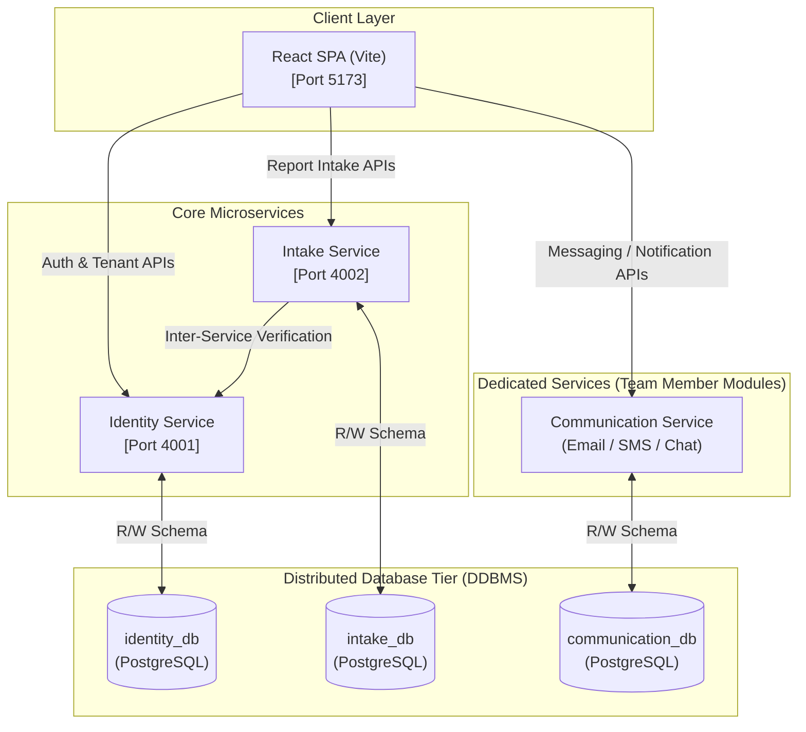
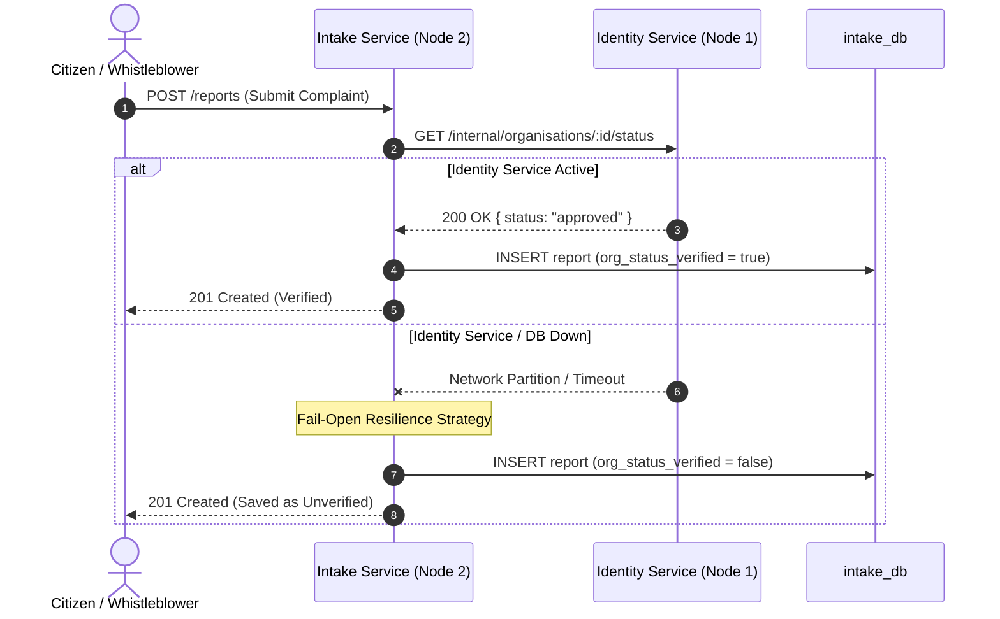

# QuietLedger

**Every case, on record. Every identity, off record.**

A multi-tenant, consent-driven platform for civic safety and workplace complaint reporting built on a **Distributed Database Management System (DDBMS)** microservices architecture.

---

## Team 9

- **Aishwarya M Mathapati** — 231CS107
- **Annabathula Bhavya Sri** — 231CS112
- **Dhiya N** — 231CS121
- **Bukke Lahari** — 231CS217

---

## Problem Statement

Civic safety and workplace misconduct reporting are traditionally handled through fragmented, low-trust channels (phone calls, walk-ins, email, spreadsheets). These channels lack end-to-end case lifecycle tracking, granular access controls, and verifiable anonymity guarantees—reporters often remain silent out of fear of retaliation.

---

## Key Features

- **Dual-Track Intake:**
  - **Internal Whistleblowing:** Workplace misconduct complaints routed to verified Organisation HR & Compliance teams.
  - **External Incidents:** Public safety incidents auto-routed to nearby Police Stations.
- **Consent-Driven Anonymity:** Per-report anonymity selection (`is_anonymous: true`) generating a unique tracking token while scrubbing reporter IDs from handler query views.
- **Sequential Lifecycle State Machine:** Enforces valid status transitions (`submitted` $\rightarrow$ `under_review` $\rightarrow$ `resolved` / `closed`).
- **Break-Glass Emergency Disclosure:** Restricts identity unmasking to Platform Admins with mandatory legal/emergency justification, recorded in an immutable audit log.
- **Unlisted Entity Request & Approval:** Allows users to request unlisted organisations or police stations, which enter `pending` status until a Platform Admin reviews and approves them.

---

## Microservices Topology & Database Boundaries

QuietLedger strictly enforces **Microservice Database Autonomy** (Database-per-Service Pattern). Each microservice owns its independent PostgreSQL database instance and schema. Services communicate exclusively via REST APIs or Event Streams—never through shared SQL tables or cross-service database locks.



---

## Microservice Database Ownership Matrix

| Microservice | Database | Primary Schema & Entities Owned | Responsibility |
|---|---|---|---|
| **Identity Service** (`identity-service`) | `identity_db` | `users`, `organisations`, `police_stations` | User registration, authentication (JWT), organisation & police station registries, admin approval workflows. |
| **Intake Service** (`intake-service`) | `intake_db` | `reports`, `audit_log` | Confidential report intake, tracking tokens, handler case queue assignment, lifecycle status state machine, break-glass disclosures. |
| **Communication Service** (`communication-service`) | `communication_db` | `messages`, `notifications` | *(Handled by dedicated team member)* Asynchronous Email & SMS delivery engine and report chat messaging. |

---

## Why QuietLedger Represents Distributed Database Management (DDBMS)

### 1. Database Autonomy & Zero Cross-Database Foreign Keys
* `identity_db` and `intake_db` are separate, autonomous PostgreSQL instances.
* Direct SQL joins across services are prohibited.
* In `intake_db`, relational fields like `reporter_id`, `org_id`, and `station_id` are stored as plain decoupled integers, preserving microservice database boundaries.

### 2. Application-Level Integrity & Decoupled Verification
* Cross-domain referential integrity is validated dynamically via inter-service REST endpoints (`/internal/organisations/:id/status`).

### 3. Fail-Open Distributed Fault Tolerance

* If `identity_db` is unavailable during a network partition, `intake-service` continues accepting urgent reports (`org_status_verified = false`), ensuring maximum system availability.

### 4. Zero-Knowledge Identity Protection
* Sensitive user credentials (`email`, `password_hash`, `phone_number`) are isolated inside `identity_db`. `intake_db` contains no personal identity data, ensuring handlers only see sanitized report queues (`reporter_id: null` when anonymous).

---

## Database Schemas (Core Microservices)

### `identity_db` (Owned by `identity-service`)

```sql
CREATE TYPE role AS ENUM ('citizen', 'organisation', 'police', 'platform_admin');
CREATE TYPE tenant_status AS ENUM ('pending', 'approved');

CREATE TABLE organisations (
  id SERIAL PRIMARY KEY,
  name TEXT NOT NULL,
  contact_email TEXT,
  contact_phone TEXT,
  requested_by_user_id INTEGER,
  status tenant_status NOT NULL DEFAULT 'pending',
  approved_at TIMESTAMP,
  approved_by_user_id INTEGER,
  created_at TIMESTAMP NOT NULL DEFAULT now()
);

CREATE TABLE police_stations (
  id SERIAL PRIMARY KEY,
  name TEXT NOT NULL,
  lat DOUBLE PRECISION NOT NULL,
  lng DOUBLE PRECISION NOT NULL,
  contact_email TEXT,
  contact_phone TEXT,
  requested_by_user_id INTEGER,
  status tenant_status NOT NULL DEFAULT 'pending',
  approved_at TIMESTAMP,
  approved_by_user_id INTEGER,
  created_at TIMESTAMP NOT NULL DEFAULT now()
);

CREATE TABLE users (
  id SERIAL PRIMARY KEY,
  name TEXT NOT NULL,
  email TEXT UNIQUE NOT NULL,
  phone_number TEXT,
  password_hash TEXT NOT NULL,
  role role NOT NULL,
  org_id INTEGER REFERENCES organisations(id),
  station_id INTEGER REFERENCES police_stations(id),
  created_at TIMESTAMP NOT NULL DEFAULT now()
);
```

---

### `intake_db` (Owned by `intake-service`)

```sql
CREATE TABLE reports (
  id SERIAL PRIMARY KEY,
  reporter_id INTEGER NOT NULL, -- Decoupled integer reference
  type TEXT NOT NULL CHECK (type IN ('external', 'internal')),
  org_id INTEGER,
  station_id INTEGER,
  is_anonymous BOOLEAN NOT NULL DEFAULT false,
  tracking_token TEXT,
  status TEXT NOT NULL DEFAULT 'submitted' CHECK (status IN ('submitted', 'under_review', 'resolved', 'closed')),
  description TEXT NOT NULL,
  org_status_verified BOOLEAN NOT NULL DEFAULT false,
  created_at TIMESTAMP NOT NULL DEFAULT now()
);

CREATE TABLE audit_log (
  id SERIAL PRIMARY KEY,
  actor_id INTEGER NOT NULL,
  action TEXT NOT NULL,
  target_id INTEGER,
  details TEXT,
  created_at TIMESTAMP NOT NULL DEFAULT now()
);
```

---

## Getting Started

### 1. Database Setup
```sql
CREATE DATABASE identity_db;
CREATE DATABASE intake_db;
```
- Run [services/identity-service/sql/init.sql](file:///c:/Users/Dhiya%20Natarajan/Documents/Quiet-Ledger/services/identity-service/sql/init.sql) in `identity_db`.
- Run [services/intake-service/sql/init.sql](file:///c:/Users/Dhiya%20Natarajan/Documents/Quiet-Ledger/services/intake-service/sql/init.sql) in `intake_db`.

### 2. Running Microservices
```bash
# Terminal 1: Identity Service (Port 4001)
cd services/identity-service && npm start

# Terminal 2: Intake Service (Port 4002)
cd services/intake-service && npm start

# Terminal 3: React Frontend (Port 5173)
cd client && npm run dev
```
